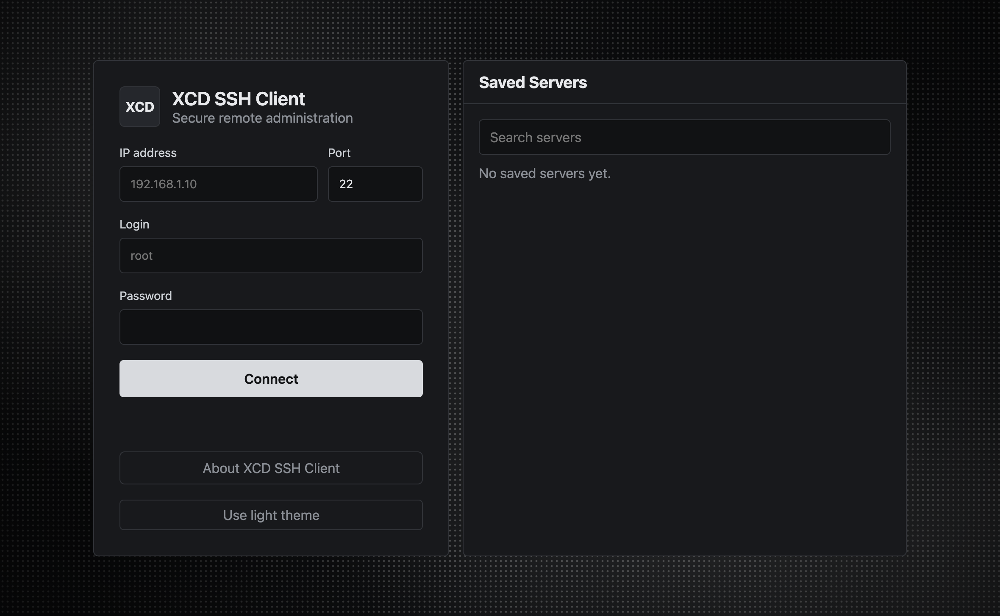
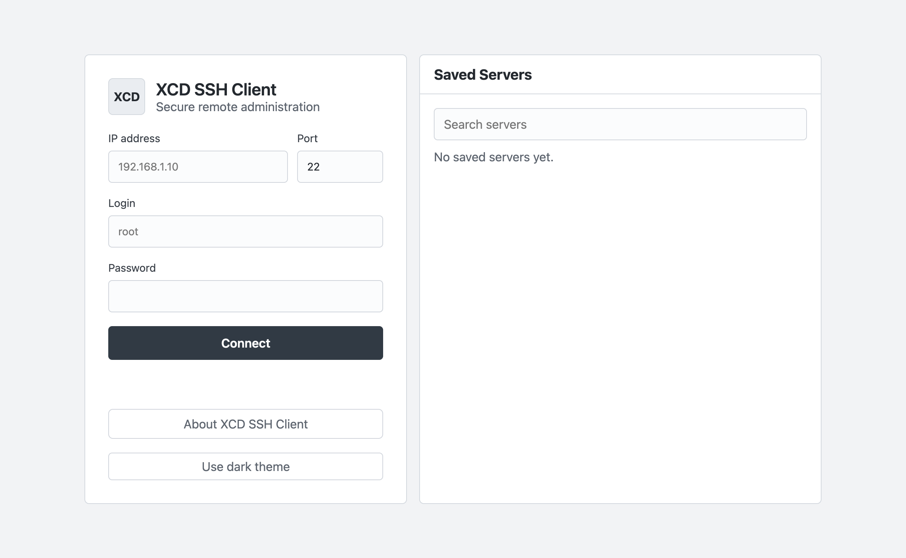
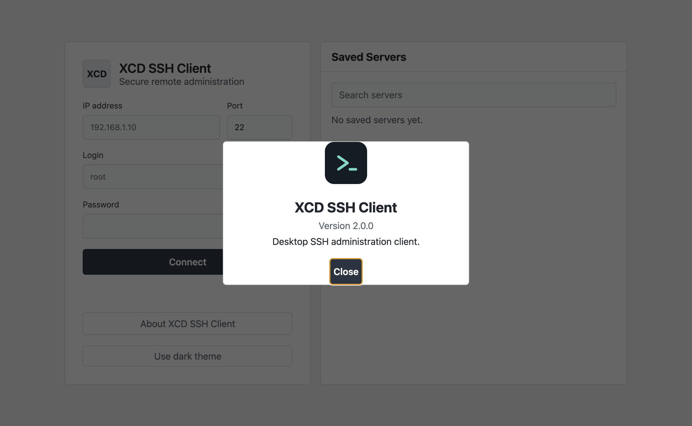

# XCD SSH Client


[](LICENSE)

**XCD SSH Client 2.0.0** is an SSH-first Electron desktop client for server administration. It brings saved server profiles, multiple sessions, an interactive shell, remote file management, and system information together; optional sing-box routing applies VPN profiles to SSH connections.

[Русская версия](README.ru.md) · [Installation](docs/en/installation.md) · [Quick start](docs/en/quick-start.md) · [Security audit](SECURITY_AUDIT.md)

> **Release status:** 2.0.0 is prepared in this source tree but has not been published. The original project source is licensed under Apache-2.0. Public distribution is held until bundled binary license and notice review is complete and all platform builds are verified. See [the audit report](SECURITY_AUDIT.md).

## Screenshots

These screenshots use a clean test profile with no saved connections or personal data.







## Features

- Password based SSH connections with first connection host key review and remembered fingerprints.
- Multiple active server sessions, saved connection details, and session switching.
- Interactive remote shell and command output in the dashboard.
- SFTP file listing, text preview, file and folder creation, confirmed deletion, and upload through the operating system file picker.
- Remote system information.
- Optional sing-box VPN routing for SSH connections, including VLESS profiles and supported subscription imports.
- Remote bot process controls, including a systemd user-service mode on compatible Linux servers.

The client does not currently support SSH private key authentication or an SSH agent. The file manager previews text files up to 256 KB and does not download files to the local machine. See [known limitations](docs/en/ssh-keys.md) and [SFTP](docs/en/sftp.md).

## Platforms and packaging

Build targets are Windows x64 (NSIS installer and portable EXE), Linux x64 (AppImage), and macOS arm64 and x64 (DMG). The Debian target is disabled until a public project homepage and maintainer email are configured. Build results and remaining runtime checks are recorded in [the security audit](SECURITY_AUDIT.md).

The bundled macOS sing-box executable is arm64. On Intel Macs, optional VPN routing requires a compatible x64 sing-box executable available on `PATH`.

## Development

Requirements: Node.js 22.12 or newer and npm.

```sh
npm ci
npm start
npm test
npm run lint
```

Packaging commands:

```sh
npm run dist:win
npm run dist:linux
npm run dist:mac:arm64
npm run dist:mac:x64
```

Build output is written to `release/`. macOS and Windows distribution signing and notarization are not configured. Do not describe generated packages as signed or notarized.

## Data and security

Server passwords are used in memory for the active SSH session and are not saved in server profiles. SSH host fingerprints, server metadata, VPN profiles, and bot definitions are stored in the application data directory. VPN profile credentials are stored in a local JSON file protected by filesystem permissions where the platform supports them; they are not encrypted with the operating system keychain.

On first launch after the XCD rename, the app copies known configuration files from the previous `desktop-ssh-client` or `Desktop SSH Client` data directory. Existing files are not overwritten and the old directory is left in place.

## Documentation

- [Installation](docs/en/installation.md) · [Quick start](docs/en/quick-start.md)
- [SSH connections](docs/en/ssh-connections.md) · [SSH keys](docs/en/ssh-keys.md)
- [SFTP](docs/en/sftp.md) · [Terminal](docs/en/terminal.md)
- [Settings and stored data](docs/en/settings.md) · [Security](docs/en/security.md)
- [Architecture](docs/en/architecture.md) · [Building](docs/en/building.md)
- [Contributing](docs/en/contributing.md) · [Troubleshooting](docs/en/troubleshooting.md)
- [Русская документация](docs/ru/installation.md)

## License

The original project source is licensed under Apache-2.0. Third-party components retain their own terms; see [THIRD_PARTY_NOTICES.md](THIRD_PARTY_NOTICES.md). This license does not by itself grant rights to redistribute bundled third-party binaries.
