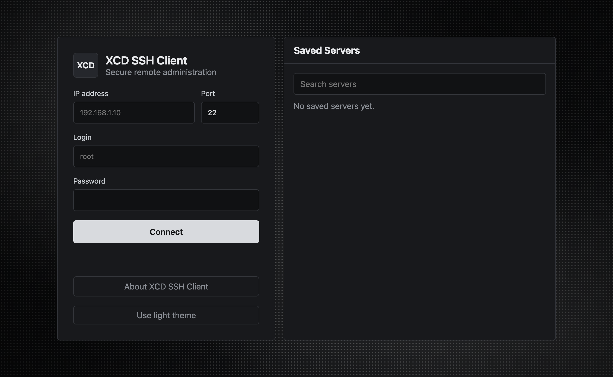
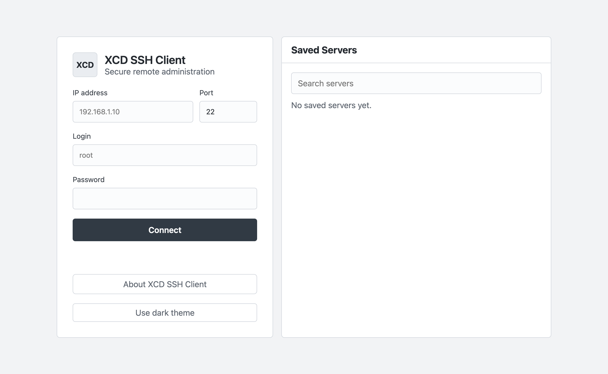
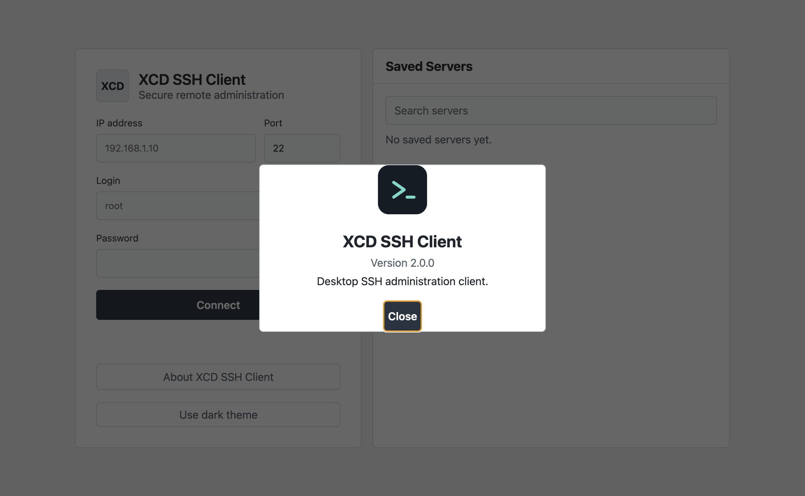

# XCD SSH Client


[](LICENSE)

**XCD SSH Client 2.0.0** — SSH-клиент на Electron для администрирования серверов. В приложении есть сохранённые профили серверов, несколько сессий, интерактивная оболочка, управление файлами и системная информация; опциональный sing-box применяет VPN-профили для маршрутизации SSH-подключений.

[English version](README.md) · [Установка](docs/ru/installation.md) · [Быстрый старт](docs/ru/quick-start.md) · [Отчёт аудита безопасности](SECURITY_AUDIT.md)

> **Статус релиза:** версия 2.0.0 подготовлена в исходном дереве, но не опубликована. Исходный код проекта лицензирован по Apache-2.0. Публикация отложена до проверки лицензий и уведомлений включённых бинарников, а также сборок для всех платформ. Подробности — в [отчёте аудита](SECURITY_AUDIT.md).

## Скриншоты

Снимки сделаны в чистом тестовом профиле без сохранённых подключений и личных данных.







## Возможности

- Подключение по паролю SSH с проверкой ключа сервера при первом соединении и сохранением отпечатка.
- Несколько активных SSH-сессий, сохранённые параметры подключения и переключение между сессиями.
- Интерактивная удалённая оболочка и вывод команд в панели приложения.
- Просмотр файлов через SFTP, предпросмотр текста, создание файлов и папок, удаление с подтверждением и загрузка через системный диалог выбора файлов.
- Информация о системе удалённого сервера.
- Опциональная маршрутизация SSH-подключений через sing-box VPN-профили, включая VLESS и поддерживаемые импорты подписок.
- Управление процессами ботов, включая режим пользовательской службы systemd на совместимых Linux-серверах.

Сейчас приложение не поддерживает SSH-аутентификацию приватным ключом и SSH-agent. Файловый менеджер показывает текстовые файлы размером до 256 КБ и не скачивает файлы на компьютер. См. [ограничения SSH-ключей](docs/ru/ssh-keys.md) и [описание SFTP](docs/ru/sftp.md).

## Платформы и сборки

Сборки настроены для Windows x64 (установщик NSIS и portable EXE), Linux x64 (AppImage), macOS arm64 и x64 (DMG). Сборка DEB отключена, пока не заданы публичная страница проекта и email сопровождающего. Результаты сборок и оставшиеся проверки запуска указаны в [отчёте аудита безопасности](SECURITY_AUDIT.md).

## Разработка

Требования: Node.js 22.12 или новее и npm.

```sh
npm ci
npm start
npm test
npm run lint
```

Сборки установщиков:

```sh
npm run dist:win
npm run dist:linux
npm run dist:mac:arm64
npm run dist:mac:x64
```

Результаты появляются в `release/`. Подпись и нотариальное заверение выпусков для macOS и Windows не настроены. Не называйте собранные пакеты подписанными или нотариально заверенными.

## Данные и безопасность

Пароль сервера хранится в памяти активной SSH-сессии и не записывается в профиль сервера. Отпечатки SSH host key, сведения о серверах, VPN-профили и настройки ботов хранятся в каталоге данных приложения. Учётные данные VPN находятся в локальном JSON-файле; на платформах, которые это поддерживают, файл ограничен правами доступа, но не шифруется системным хранилищем секретов.

При первом запуске XCD после ребрендинга приложение копирует известные файлы настроек из старого каталога `desktop-ssh-client` или `Desktop SSH Client`. Существующие файлы не перезаписываются, старый каталог сохраняется.

## Документация

- [Установка](docs/ru/installation.md) · [Быстрый старт](docs/ru/quick-start.md)
- [SSH-подключения](docs/ru/ssh-connections.md) · [SSH-ключи](docs/ru/ssh-keys.md)
- [SFTP](docs/ru/sftp.md) · [Терминал](docs/ru/terminal.md)
- [Настройки и данные](docs/ru/settings.md) · [Безопасность](docs/ru/security.md)
- [Архитектура](docs/ru/architecture.md) · [Сборка](docs/ru/building.md)
- [Участие в разработке](docs/ru/contributing.md) · [Устранение проблем](docs/ru/troubleshooting.md)
- [English documentation](docs/en/installation.md)

## Лицензия

Исходный код проекта лицензирован по Apache-2.0. Сторонние компоненты сохраняют собственные условия; см. [THIRD_PARTY_NOTICES.md](THIRD_PARTY_NOTICES.md). Эта лицензия сама по себе не даёт прав на распространение сторонних бинарников.
